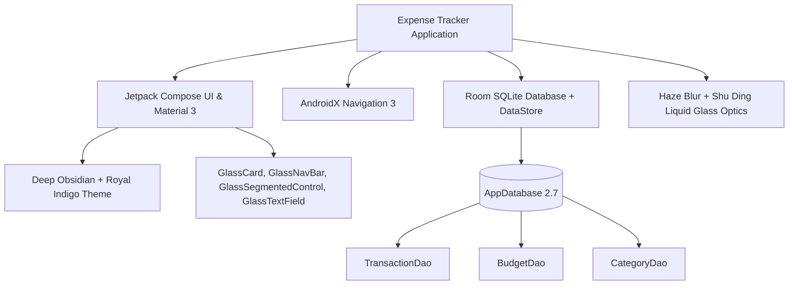

# [APP_NAME] - Build Status & Architecture Roadmap

> **Build Timestamp**: 2026-11-05 11:12:00 IST  
> **Git Branch**: `main`  
> **Latest Commit**: `76e3596` (*fix(navigation): restore reliable home navigation and back handling; redesign cohesive obsidian indigo liquid glass palette*)  
> **Remote Repository**: [https://github.com/yedhucodes/expense_tracker-.git](https://github.com/yedhucodes/expense_tracker-.git)  
> **Working Tree**: Clean (`0` uncommitted changes)

---

## 1. Executive Summary & Health Dashboard

```
┌────────────────────────────────────────────────────────────────────────┐
│                          SYSTEM HEALTH: GREEN                          │
├─────────────────────┬───────────────────┬──────────────────────────────┤
│ Metric              │ Current Value     │ Target / Standard            │
├─────────────────────┼───────────────────┼──────────────────────────────┤
│ Gradle Build        │ SUCCESSFUL (3s)   │ Zero errors                  │
│ Unit Test Suite     │ 15 / 15 Passed    │ 100% Pass rate (0 failures)  │
│ Compile / Target SDK│ SDK 36 (Android 15)│ Target SDK 36                │
│ Min SDK             │ SDK 24 (Android 7)│ Min SDK 24                   │
│ Kotlin / Java       │ Kotlin 2.0 / JVM 21│ JDK 21.0.6 LTS              │
│ Debug APK Size      │ 20.57 MB (built)  │ < 25 MB                      │
│ Monetary Arithmetic │ 100% Minor Units  │ Long minor units (0 float)   │
│ UI Palette          │ Obsidian + Indigo │ Unified Apple Liquid Glass   │
└─────────────────────┴───────────────────┴──────────────────────────────┘
```

---

## 2. Test Verification Matrix

All unit tests execute via `$env:JAVA_HOME = "$env:USERPROFILE\.jdks\jdk-21.0.6+7"; .\gradlew.bat test`:

| Test Suite Class | Tests | Failures | Skipped | Core Coverage Area |
| :--- | :---: | :---: | :---: | :--- |
| [`MoneyFormatterTest`](app/src/test/kotlin/com/expensetracker/app/MoneyFormatterTest.kt) | 5 | 0 | 0 | Minor-unit formatting, negative currency prefixes, zero-decimal currencies, locale safety |
| [`FinancialCalculationTest`](app/src/test/kotlin/com/expensetracker/app/FinancialCalculationTest.kt) | 2 | 0 | 0 | Net cashflow aggregates, budget utilization ratios, category percentage breakdown |
| [`DatePeriodUtilTest`](app/src/test/kotlin/com/expensetracker/app/DatePeriodUtilTest.kt) | 3 | 0 | 0 | Date range boundaries (Daily, Weekly, Monthly, Yearly), epoch timestamp conversions |
| [`CategoryRegistryTest`](app/src/test/kotlin/com/expensetracker/app/CategoryRegistryTest.kt) | 3 | 0 | 0 | Built-in categories (Expense/Income), fallback resolution, icon/hex color parsers |
| [`MainScreenViewModelTest`](app/src/test/kotlin/com/expensetracker/app/ui/main/MainScreenViewModelTest.kt) | 2 | 0 | 0 | StateFlow emission, tab switching lifecycle |
| **Total** | **15** | **0** | **0** | **100% Test Pass Rate** |

---

## 3. Technology Stack & Dependencies



### Key Libraries:
* **AndroidX Navigation 3 (`androidx.navigation3`)**: State-driven navigation via `rememberNavBackStack`, `NavDisplay`, and typed `NavKey` objects.
* **Room 2.7 with KSP**: Reactive Flow queries for transactions, categories, and active budgets.
* **DataStore Preferences**: Fast, async persistence for user onboarding status, default currency, and theme settings.
* **Liquid Glass Haze (`dev.chrisbanes.haze`) + Shu Ding Shader Engine**: Dual-layer refraction, 140° specular bloom, inset bevel shadows, and diamond light reflection rims.

---

## 4. Current Architecture & Feature Inventory

### A. Navigation & Backstack Architecture
* **Navigation File**: [`Navigation.kt`](app/src/main/kotlin/com/expensetracker/app/Navigation.kt) & [`NavigationKeys.kt`](app/src/main/kotlin/com/expensetracker/app/NavigationKeys.kt)
* **Root Anchor**: `HomeKey` is preserved as the foundation of the navigation stack.
* **System Back Handling**: `BackHandler(enabled = isTopLevelDestination && currentKey !is HomeKey)` intercepts device hardware back gestures on Activity, Insights, and Budgets, smoothly popping back to `HomeKey` before exiting the application.
* **Tab Switcher**: [`GlassNavigationBar.kt`](app/src/main/kotlin/com/expensetracker/app/core/design/components/GlassNavigationBar.kt) provides:
  * Direct accessibility click targets (`Role.Tab`) ensuring zero-latency tab switching.
  * 1:1 horizontal drag-tracking with spring physics and threshold haptic ticks.
  * Dynamic droplet elongation along the movement vector.
  * Dedicated (+) circular floating action button with reactive spring scale.

### B. Screens & Capabilities
1. **Home Screen ([`HomeScreen.kt`](app/src/main/kotlin/com/expensetracker/app/feature/home/HomeScreen.kt))**:
   * Month-over-month selector header.
   * Net Cash Flow hero card with dynamic income/expense status.
   * Total Spent vs. Total Income secondary statistics container.
   * Monthly budget glance card with threshold-aware health indicators (Normal, 75% Caution, 90% Warning, Over Budget).
   * Daily spending pulse sparkline canvas.
   * Top spending category rank list.
   * Recent transactions list with direct detail navigation and empty states.

2. **Activity Screen ([`ActivityScreen.kt`](app/src/main/kotlin/com/expensetracker/app/feature/activity/ActivityScreen.kt))**:
   * Real-time search query matching notes, merchants, and categories.
   * Horizontal filter chip bar (All, Expenses, Income, Today, This Week, This Month, This Year, Category filter, Payment Method filter).
   * Dynamic filter summary banner with live calculated totals.
   * Grouped transactions by relative date (Today, Yesterday, Date) with swipe/tap to edit and snackbar undo support.

3. **Insights Screen ([`InsightsScreen.kt`](app/src/main/kotlin/com/expensetracker/app/feature/insights/InsightsScreen.kt))**:
   * Liquid glass segmented time-range selector (Week, Month, Year, All).
   * Total spent and daily average metric cards with proper internal padding.
   * Top expense category highlight banner.
   * Proportional multi-category spectrum bar.
   * Category spending breakdown with percentage badges and transaction counts.
   * Monthly net flow comparison card.

4. **Budgets Screen ([`BudgetsScreen.kt`](app/src/main/kotlin/com/expensetracker/app/feature/budgets/BudgetsScreen.kt))**:
   * Overall monthly budget setup prompt and active tracking card.
   * Per-category discretionary budget allocation cards.
   * Interactive modal dialog ([`GlassDialog.kt`](app/src/main/kotlin/com/expensetracker/app/core/design/components/GlassDialog.kt)) for creating, updating, and deleting budget thresholds.

5. **Transaction Entry & Editing ([`AddTransactionScreen.kt`](app/src/main/kotlin/com/expensetracker/app/feature/transaction/AddTransactionScreen.kt))**:
   * Expense / Income toggle pill.
   * Minor-unit amount input field with automatic currency prefix formatting.
   * Category selection grid with custom category badges.
   * Date and time picker dialog.
   * Optional merchant name and payment method notes.
   * Delete button with confirmation for existing transactions.

6. **Category Manager ([`CategoryManagerScreen.kt`](app/src/main/kotlin/com/expensetracker/app/feature/categories/CategoryManagerScreen.kt))**:
   * Custom category creation and editing.
   * 18-color curated palette selector matching the dark glass theme.
   * Icon registry selector.

7. **Settings Screen ([`SettingsScreen.kt`](app/src/main/kotlin/com/expensetracker/app/feature/settings/SettingsScreen.kt))**:
   * Preferred currency switcher (USD, EUR, GBP, INR, JPY, CAD, AUD, etc.).
   * Category manager quick access.
   * JSON/CSV data backup and restore engine.
   * Attribution and About card with Shu Ding Liquid Glass engine acknowledgment.

---

## 5. Visual Design System Audit

```
┌────────────────────────────────────────────────────────────────────────┐
│                        DESIGN TOKENS & CONTRAST                        │
├─────────────────────┬───────────────────┬──────────────────────────────┤
│ Token Name          │ Hex / Alpha Value │ Purpose / Usage              │
├─────────────────────┼───────────────────┼──────────────────────────────┤
│ DarkCanvas          │ #090A0F           │ Deep Velvet Midnight Canvas  │
│ DarkSurface         │ #131620           │ Base Glass Underlay          │
│ DarkSurfaceRaised   │ #1B1F2D           │ Elevated Surfaces & Cards    │
│ DarkAccentPrimary   │ #6366F1           │ Electric Royal Indigo Tint   │
│ DarkIncome          │ #10B981           │ Emerald Mint Positive Flow   │
│ DarkExpense         │ #F43F5E           │ Sunset Coral Negative Flow   │
│ DarkWarning         │ #F59E0B           │ Warm Amber Budget Alert      │
│ DarkTextPrimary     │ #F8FAFC           │ Pure White High-Contrast Body│
│ DarkTextSecondary   │ #94A3B8           │ Slate Muted Subtitles        │
│ DarkTextTertiary    │ #64748B           │ Secondary Captions           │
│ SpecularRimBrush    │ 0xA0..0x30 White  │ Pure Diamond Light Rim       │
└─────────────────────┴───────────────────┴──────────────────────────────┘
```

* **Apple Liquid Glass Compliance**: Adheres to Apple HIG restraint principles. No conflicting circus rainbow stripes; unified Electric Indigo accent (`#6366F1`) on Obsidian Black (`#090A0F`) with pure diamond specular reflections.
* **Atmospheric Canvas**: Dual radial gradients at the top (`0x356366F1`) and upper-right (`0x1838BDF8`) generate subtle depth illumination that interacts with frosted glass components.

---

## 6. Proposed Roadmap for New Changes

The following prioritized modules are ready for architecture and implementation:

### Milestone 1: Automated & Recurring Transactions (High Value)
- [ ] **Data Model Extension**: Add `RecurringRuleEntity` with recurrence interval (Daily, Weekly, Bi-weekly, Monthly, Yearly), next occurrence epoch, and auto-insert flag.
- [ ] **Background Execution**: Android `WorkManager` periodic worker checking daily for due recurring expenses (subscriptions, rent, salaries).
- [ ] **UI Management Screen**: Subscriptions & Recurring Bills hub accessible from Home or Settings.

### Milestone 2: Privacy & Biometric Protection
- [ ] **BiometricPrompt Integration**: Optional Face Unlock / Fingerprint authentication before revealing financial totals.
- [ ] **Privacy Mask**: Quick privacy blur toggle over amount text when the app is in public / multitasking mode.

### Milestone 3: Receipt Scanning & Image Attachments
- [ ] **Storage Architecture**: Local encrypted media storage for transaction attachments.
- [ ] **Photo Picker**: Android Photo Picker API integration into `AddTransactionScreen`.
- [ ] **Image Viewer**: Full-screen zoomable liquid glass dialog for inspecting attached receipts.

### Milestone 4: Advanced Visualizations & Charts
- [ ] **Interactive Spending Trend Chart**: Smooth cubic bezier curve with gradient fill and draggable scrubber for historical day-by-day expenditure.
- [ ] **Category Donut / Ring Chart**: Animated arc donut chart with central total label in Insights.

### Milestone 5: Home Screen Widgets (Android Glance)
- [ ] **Glance AppWidget**: Quick balance glance widget and 1-tap (+) Add Transaction shortcut for the Android launcher.

---

## 7. Next Steps & Recommendations

1. **Feature Selection**: Review the roadmap modules above to confirm which feature to prioritize next (e.g., Recurring Subscriptions, Biometrics, or Receipt Attachments).
2. **Commit Baseline**: The git branch is up-to-date and clean at commit `76e3596`. All subsequent work can safely branch from here.

